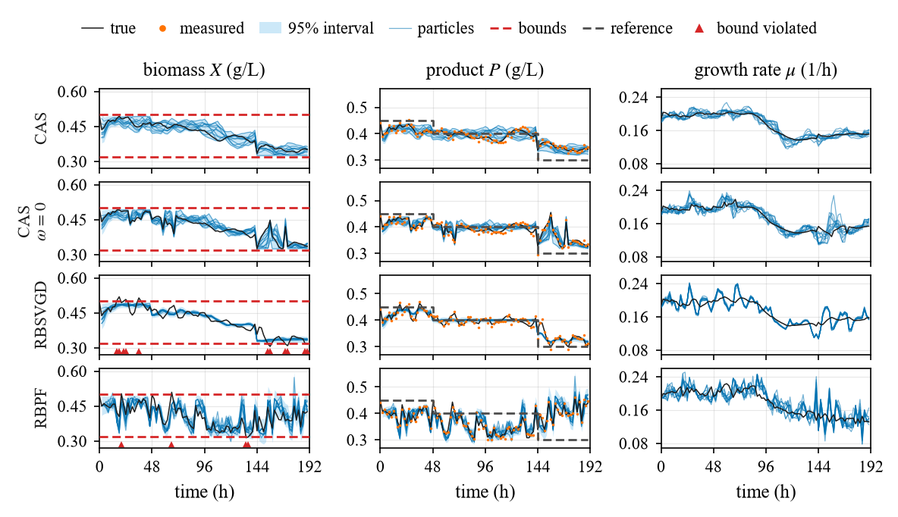
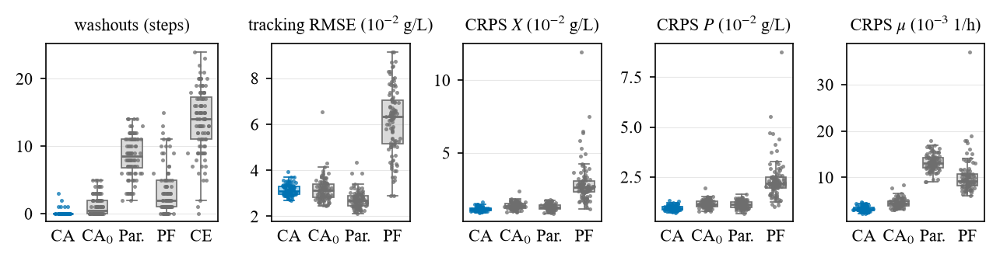

# CAS-MPC: Control-Aware Stein Filtering for Stochastic MPC

Code for the paper **Control-Aware Stein Filtering for Stochastic MPC with Online-Learned Gray-Box Neural Models**
by Milad Banitalebi Dehkordi, Manas Mejari and Dario Piga (IDSIA Dalle Molle Institute for Artificial Intelligence,
SUPSI-USI, Lugano, Switzerland).

**CAS-MPC** controls systems described by gray-box neural state-space models that are learned online. The particles
of a Rao–Blackwellized Stein variational filter serve two purposes at once: they approximate the joint posterior of
states and network parameters, and they are the scenarios of a stochastic MPC with chance constraints. A
**control-aware kernel** makes the filter spread its particles where the uncertainty matters for constraint
satisfaction. The particles still approximate the parameter posterior.

<p align="center">
  
</p>
<p align="center"><em>
One closed-loop run on the bioreactor (seed 11). Rows: CAS-MPC, CAS-MPC with ω = 0, RBSVGD-MPC and RBPF-MPC. Columns:
the unmeasured biomass with its bounds, the measured product with its reference, and the learned growth rate. Shaded
bands are 95% forecast intervals, thin lines are particles, and triangles mark bound violations.
</em></p>

## The idea

At each sampling time, CAS-MPC solves three subproblems with one set of $N$ particles:

1. **Learning.** RBSVGD approximates $p(x_t, \theta \mid y_{1:t})$. Each particle $\theta^{(i)}$ carries its own
   extended Kalman filter, and the particles move by Stein variational gradient descent towards the parameter posterior.
   Prior knowledge about the network, such as the sign of a derivative of a learned rate, is imposed as constraints
   $\kappa(\theta) \le 0$.
2. **Control.** Each particle, together with its state estimate, is one scenario of a scenario-based SMPC. The chance
   constraints are evaluated in closed form over the mixture of the scenarios' Gaussian predictions.
3. **Control-aware learning.** The standard kernel compares particles by their distance in parameter space. That
   distance is a poor proxy for what the controller sees: permuting hidden units leaves the model unchanged, and many
   directions barely affect the predictions. The control-aware kernel compares particles by the outputs and constraint
   margins $\Phi_t(\theta)$ they predict under the planned input:

$$
k_\omega(\theta, \theta') = \exp\!\Big(-\frac{\lVert \Phi_t(\theta) - \Phi_t(\theta')\rVert^2}{b_\Phi}\Big)
  + \omega \exp\!\Big(-\frac{\lVert \theta - \theta'\rVert^2}{b_\theta}\Big).
$$

Only the kernel changes, so the SVGD descent property is kept. The parameter-space term ($\omega > 0$) ensures that the
particles keep approximating the posterior even when the predictions do not depend on some directions of $\theta$. The
paper also bounds the closed-loop violation of the chance constraints by a model, a posterior and a particle error term.

## Results

The benchmark is a continuous bioreactor with Haldane kinetics:
- the mixing efficiency drops during the run, and the controller doesn't know it;
- the growth rate is learned online by a network with 33 weights;
- only the product is measured, and the unmeasured biomass must stay within bounds (chance constraints with
  $\delta = 0.01$).

All methods use $N = 10$ particles. Results over 100 closed-loop runs (mean ± standard deviation):

| | RBPF-MPC | RBSVGD-MPC | CAS-MPC, ω = 0 | **CAS-MPC** |
|---|---|---|---|---|
| violations below / above the bounds (% of steps) | 2.7 / 0.8 | 5.5 / 3.4 | 0.89 / 0.34 | **0.04 / 0.05** |
| tracking RMSE (10⁻² g/L) | 6.15 ± 1.42 | **2.72 ± 0.37** | 3.16 ± 0.52 | 3.14 ± 0.23 |
| CRPS of the biomass forecast (10⁻² g/L) | 2.90 ± 1.42 | 1.29 ± 0.20 | 1.37 ± 0.24 | **1.14 ± 0.13** |
| CRPS of the product forecast (10⁻² g/L) | 2.35 ± 1.00 | 1.12 ± 0.19 | 1.15 ± 0.20 | **0.93 ± 0.12** |
| CRPS of the learned growth rate (10⁻³ 1/h) | 10.2 ± 3.8 | 13.2 ± 1.8 | 4.49 ± 0.94 | **3.24 ± 0.51** |
| computation per step (ms) | 295 ± 77 | **163 ± 34** | 174 ± 21 | 193 ± 46 |

CAS-MPC keeps the violations far below δ and learns the kinetics most accurately, at the cost of a moderately larger
tracking error than RBSVGD-MPC. The CRPS (continuous ranked probability score) scores the forecasts the controller uses;
lower is better.

<details>
<summary>Distribution over the 100 runs</summary>
<p align="center">
  
</p>
<p align="center"><em>One point per run. CA: CAS-MPC; CA₀: CAS-MPC with ω = 0; Par.: RBSVGD-MPC; PF: RBPF-MPC;
CE: certainty-equivalent MPC (violations only).</em></p>
</details>

## Getting started

Python 3.11 or later:

```bash
git clone https://github.com/MiladBnit/CAS_MPC.git
cd CAS_MPC
python -m venv .venv
.venv/Scripts/python -m pip install -e ".[notebook]"      # Linux/macOS: .venv/bin/python
```

Open the notebooks with the `.venv` environment as the kernel:

| notebook | what it does | time |
|---|---|---|
| [`run_bioreactor.ipynb`](notebooks/run_bioreactor.ipynb) | the bioreactor model and all parameters; one closed-loop run of every method (the figure above) | about 2 min |
| [`montecarlo_bioreactor.ipynb`](notebooks/montecarlo_bioreactor.ipynb) | the Monte Carlo study: the table above, violation statistics, box plots | instant from the saved results; about 1.5 h with 10 processes when rerun |

Both notebooks are rendered on GitHub with their outputs, so they can be read without running anything.

**Configuration.** All parameters live in [`config/bioreactor.yaml`](config/bioreactor.yaml), loaded on top of
`config/default.yaml`. Seeds are fixed, and every result folder stores the configuration that produced it. The
notebooks reuse saved results when they run again with the same configuration.

## Repository layout

```
config/          benchmark definition (plant, model, filters, controller, reference)
notebooks/       single run and Monte Carlo study
results/         saved Monte Carlo results of the paper (metrics per run, configuration)
src/carbsgd/     implementation
assets/          figures shown in this README
```

The methods are named as follows in the code:

| paper | code | filter | controller |
|---|---|---|---|
| CAS-MPC | `ca` | RBSVGD with the control-aware kernel $k_\omega$, $\omega = 1$ | scenario SMPC |
| CAS-MPC, ω = 0 | `ca0` | RBSVGD with $k_\Phi$ alone | scenario SMPC |
| RBSVGD-MPC | `param` | RBSVGD with the parameter-space kernel $k_\theta$ | scenario SMPC |
| RBPF-MPC | `rbpf` | Rao–Blackwellized particle filter, rejection of particles that violate $\kappa(\theta) \le 0$ | scenario SMPC (weighted) |
| CE-MPC | `ce` | the CAS-MPC filter | certainty-equivalent MPC on the particle mean |

Modules of `src/carbsgd/`:

| module | content |
|---|---|
| `bioreactor.py` | plant, gray-box model with the learned growth rate, inhibition laws |
| `ekf.py`, `score.py` | per-particle EKF, one-step predictive likelihood and its score |
| `kernels.py`, `features.py` | parameter-space and control-aware kernels, feature map $\Phi_t$ |
| `filters.py`, `constraints.py` | RBSVGD (Stein variational Newton step, MDMM constraints), RBPF |
| `scenarios.py`, `mpc.py` | scenario propagation, mixture chance constraints, SMPC and CE-MPC (CasADi, IPOPT) |
| `closed_loop.py`, `bio_setup.py` | closed loop, setup of the case study, metrics of a run |
| `metrics.py`, `bio_mc.py`, `plots.py` | CRPS of Gaussian mixtures, Monte Carlo with saved results, figures |

The implementation uses JAX (models, filters, derivatives) and CasADi with IPOPT (the SMPC), in double precision.

## Related work

- M. Banitalebi Dehkordi, M. Mejari, D. Piga. *Rao–Blackwellized Stein gradient descent for joint state–parameter
  estimation.* [arXiv:2603.23039](https://arxiv.org/abs/2603.23039), 2026. The RBSVGD filter used here.
- M. Banitalebi Dehkordi, M. Forgione, G. Cimini, L. Frascati, D. Piga. *On the normalization of gray-box
  state-space neural networks.* Automatica, 183:112659, 2026. The normalization of the gray-box model.

## Citation

If you use this code, please cite the paper. GitHub's "Cite this repository" button gives the entry from
[`CITATION.cff`](CITATION.cff).

```bibtex
@misc{banitalebi2026casmpc,
  title  = {Control-Aware Stein Filtering for Stochastic {MPC} with Online-Learned Gray-Box Neural Models},
  author = {Banitalebi Dehkordi, Milad and Mejari, Manas and Piga, Dario},
  year   = {2026},
  note   = {Code: https://github.com/MiladBnit/CAS_MPC}
}
```

## License

[MIT](LICENSE)
